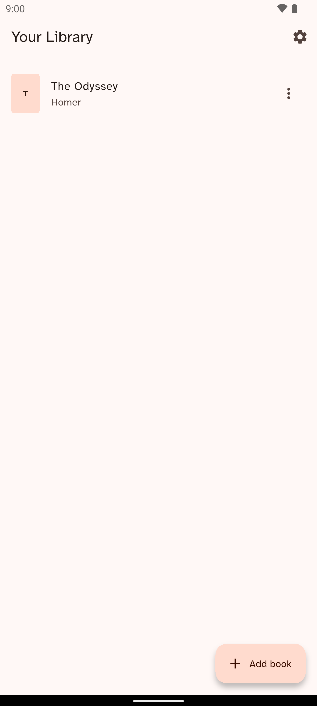
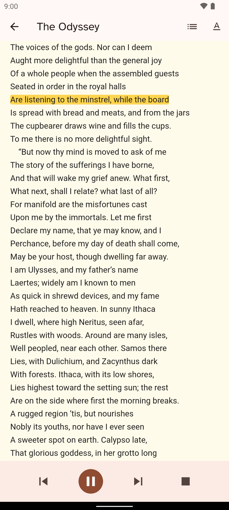
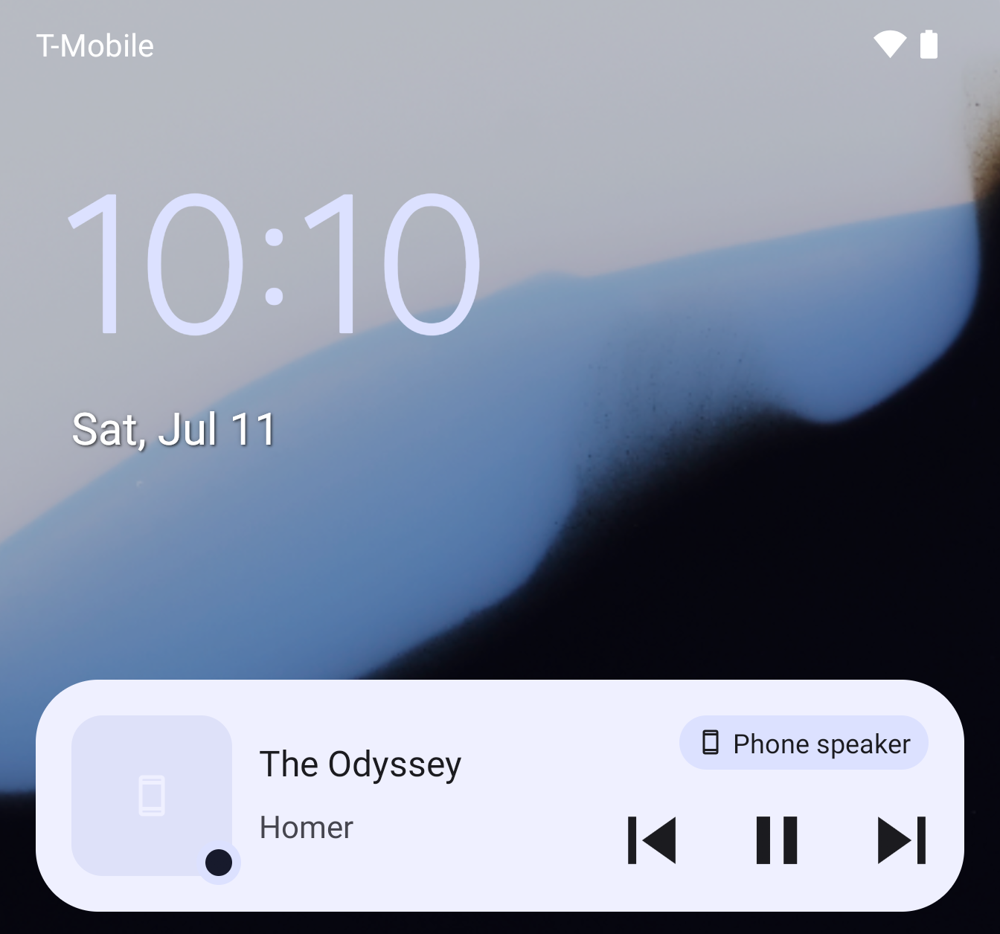

# Narrarr

[](https://github.com/nikhilsutaria/Narrarr/releases/latest)
[](LICENSE)

Narrarr reads your EPUBs out loud and highlights each sentence as it's spoken. You can follow along on the page, or put your phone in your pocket and just listen. The voice runs on the phone itself, so there's no account, no subscription, and nothing you read gets uploaded anywhere.

It's for DRM-free EPUBs you already have: Project Gutenberg and Standard Ebooks downloads, DRM-free purchases, files you made yourself. It won't open DRM-protected books, and it doesn't sell books.

It's Android only for now. iOS is planned.

[Download the latest APK](https://github.com/nikhilsutaria/Narrarr/releases/latest) · [Build from source](#building-from-source) · [Report a bug](../../issues)

| Library | Reading along | Lock screen |
|:---:|:---:|:---:|
|  |  |  |

## What it does

- Reads the book aloud and highlights the sentence being read. The page turns on its own to keep up.
- Keeps playing with the screen off. You get controls on the lock screen, in the notification, and on your headphones.
- Works offline. By default it uses your phone's built-in voice, so it starts reading straight away. If you want something more natural, download a neural voice once (about 64 MB) and it runs offline from then on.
- Plays at anywhere from 0.8× to 3× speed, without gaps between sentences or chapters.
- Says numbers, dates, money, abbreviations and Roman-numeral chapter headings the way a person would.
- Skips back or forward 10 to 60 seconds, or a paragraph at a time. If you've been paused for a while, it backs up a little when you resume so you can pick up the thread.
- Shows how much time is left in the chapter and in the book.
- Has a sleep timer (5 to 60 minutes, or the end of the chapter). It fades out and keeps your place.
- Has bookmarks.
- Lets you fix pronunciation. If the voice says a name wrong, select the word and type how it should sound, for one book or for all of them.
- Long-press a sentence to move narration there. (A proper tap-to-start is coming in [#71](../../issues/71).)
- Uses the Atkinson Hyperlegible font, and you can change text size, spacing and theme. I want Narrarr to work well for people with dyslexia or low vision, or anyone who finds a page of print hard going, so accessibility gets treated as a feature, not an afterthought.

## Installing on Android

There's no Play Store listing yet, so you install the APK directly.

1. Go to [Releases](https://github.com/nikhilsutaria/Narrarr/releases) and download `Narrarr-<version>-arm64-v8a.apk` from the newest release (about 65 MB). It runs on pretty much any Android phone from the last several years. It won't run on x86 emulators; build from source for those.
2. Open the file. The first time, Android will ask you to allow installs from the app you downloaded it with (Settings → Apps → your browser or files app → Install unknown apps). Allow it, then tap Install.
3. Open Narrarr, add an EPUB, and press Listen.

If you just want to try it without finding a book first, each release also has a `Narrarr-QA-<version>-arm64-v8a.apk`. That's a test build with *The Odyssey* and a neural voice already inside, so it reads the moment it's installed, with no network. It installs next to the normal app as "Narrarr QA".

## Voices

Narrarr starts with whatever text-to-speech voice your phone already has. These [Piper](https://github.com/rhasspy/piper) neural voices are optional downloads and sound a lot more natural:

| Voice | Size | Notes |
|---|---|---|
| System voice | Built in | Your phone's own TTS voice. The default. Quality depends on the phone. |
| Amy (low) | ~64 MB | US English. |
| Amy (medium) | ~64 MB | US English, a bit richer than Amy (low). |
| Ryan (medium) | ~64 MB | US English, male. |

To get one, open Settings (the gear at the top right of the library), then Voices, and tap the voice you want. It downloads from the [sherpa-onnx model releases](https://github.com/k2-fsa/sherpa-onnx/releases/tag/tts-models), checks the file, and unpacks it. No account is needed. Select it to make it the active voice, and remove it whenever you want the space back.

Reading speed is the chip in the player bar and applies to every voice. The QA build ships with Amy (low) already installed.

Everything is US English for now. If you'd like another language or voice, [open an issue](../../issues).

## How it works

The tricky part is keeping the highlight in step with the voice. Narrarr doesn't estimate timings. It speaks a sentence, waits until that sentence's audio has actually finished playing, and only then moves the highlight to the next one. That keeps the two in sync on any phone, at any speed.

```
EPUB  ─►  Segmenter            HTML → clean sentences to read
                               (skips nav, footnotes, captions, tables…)
            │
            ▼
        NarrationController    highlight sentence i → wait for its audio → move to i+1
            │                  (synthesizes ahead, including the next chapter)
            ▼
        NeuralNarrator         sherpa-onnx + Piper on a background isolate
            │                  (text normalization, long-sentence chunking, PCM streaming)
            ▼
        Reader + audio_service highlight on screen, lock-screen controls
```

To avoid gaps, Narrarr synthesizes a few sentences ahead (and the start of the next chapter before you get there), and streams the audio into one continuous PCM buffer rather than playing separate clips. Very long sentences are split at commas and semicolons, because Piper speeds up on long input. Synthesis runs on a background isolate, so the UI stays responsive while it works.

Built with:

- [Flutter](https://flutter.dev) for the app
- [sherpa-onnx](https://github.com/k2-fsa/sherpa-onnx) running [Piper](https://github.com/rhasspy/piper) voices, plus `flutter_tts` for the system voice
- [Readium](https://readium.org) (via `flutter_readium`) to render the EPUB and draw the highlight
- `flutter_soloud` for gapless playback, and `audio_service` for background audio and the lock screen
- [Drift](https://drift.simonbinder.eu/) (SQLite) for the library, bookmarks and reading positions

## Building from source

You'll need the [Flutter SDK](https://docs.flutter.dev/get-started/install) (Dart `^3.8`) and an Android device or emulator. The Android build needs minSdk 24, compileSdk 36 and NDK 27, because `sherpa_onnx` and `flutter_readium` require them.

```bash
git clone https://github.com/nikhilsutaria/Narrarr.git
cd Narrarr
flutter pub get
flutter run --flavor qa
```

You have to pass `--flavor`. There are two:

- `qa` bundles *The Odyssey* and the Amy (low) voice, so narration works immediately with no downloads. It installs as "Narrarr QA", next to the normal app.
- `prod` is what goes on the Releases page: an empty library and no bundled voices, so the APK stays small.

Other commands you'll probably want:

```bash
flutter analyze
flutter test
flutter build apk --flavor prod
flutter build apk --flavor qa

# after changing anything in lib/library/drift/
dart run build_runner build --delete-conflicting-outputs
```

## Status

The current release is v1.3.1. I test releases on a Pixel 8 and a Huawei P30 Pro. On Huawei/EMUI phones the app can freeze when the screen turns off during narration ([#61](../../issues/61)); that's still open.

Done so far:

- v1.0: import, the reader, offline neural narration with synced highlighting, background playback, downloadable voices
- v1.1: reads out of the box with the phone's built-in voice
- v1.2: gapless playback, 0.8×–3× speed, better reading of numbers and abbreviations
- v1.3: time left, skip and auto-rewind, sleep timer, bookmarks, pronunciation fixes

Next up:

- v1.4: highlight styles, a reading ruler, notes, search, and a better library
- iOS
- Google Play and F-Droid

Bugs and ideas go in [issues](../../issues).

## Docs

The background research is in [`docs/research/`](docs/research/README.md): [product vision](docs/research/01-product-vision.md), [market and competition](docs/research/02-market-competitive-analysis.md), [technical feasibility](docs/research/03-technical-feasibility.md), [architecture](docs/research/04-architecture-and-stack.md), [risks and legal](docs/research/05-risks-legal-compliance.md), and [sources](docs/research/sources.md).

## Contributing

Read [CONTRIBUTING.md](CONTRIBUTING.md) first; it covers setup and how PRs work. Then have a look at the [issues](../../issues) (`good first issue` is a good place to start) or open a new one. `flutter analyze` and `flutter test` need to pass before you send a PR.

If you find a security problem, please don't post it publicly. [SECURITY.md](SECURITY.md) explains how to report it.

## Supporting the project

Narrarr is free and will stay that way: no ads, no subscription, no account. I build it on my own, in my spare time.

If it's useful to you and you want to help, [GitHub Sponsors](https://github.com/sponsors/nikhilsutaria) is the place. The money goes toward:

- the Google Play developer registration
- the yearly Apple developer fee, which is the main thing standing between Narrarr and iOS
- test phones, so releases get checked on real hardware

Starring the repo, filing bugs, or telling someone who'd like being read to helps too.

## License

Narrarr is licensed under the [GNU GPL v3](LICENSE). Piper's tooling is GPL-3.0, and copyleft also keeps Narrarr and any forks open. [Technical feasibility](docs/research/03-technical-feasibility.md) and [risks and legal](docs/research/05-risks-legal-compliance.md) go into the reasoning.

Narrarr only opens DRM-free EPUBs. It doesn't remove DRM and it isn't a bookstore. The legal notes in `docs/` are my own research, not legal advice.

## Thanks

- [sherpa-onnx](https://github.com/k2-fsa/sherpa-onnx) and [Piper](https://github.com/rhasspy/piper) for the on-device voices
- [Readium](https://readium.org) and `flutter_readium` for EPUB rendering
- The Braille Institute for [Atkinson Hyperlegible](https://brailleinstitute.org/freefont)
